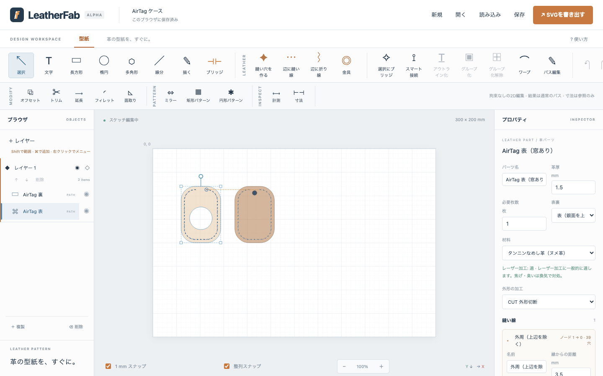
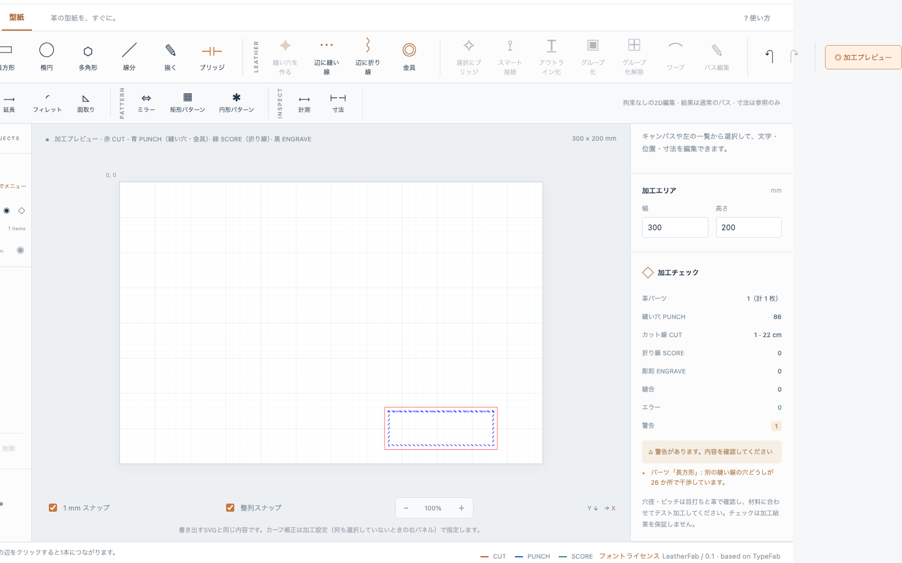
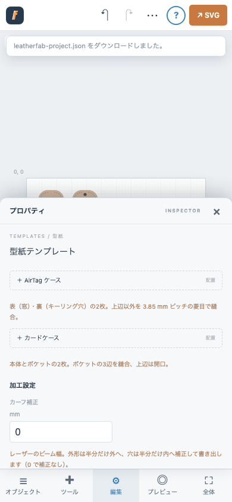

# LeatherFab

**革の型紙を、すぐに。** ブラウザで動く革製品設計 CAD。図形を描いて「縫い穴を作る」を押すと革パーツになり、外周に縫い線と縫い穴ができます。外形を動かしても穴が追従し、レーザー加工用の mm 実寸 SVG（CUT / PUNCH / SCORE / ENGRAVE）をそのまま書き出せます。

[TypeFab](https://github.com/fooping-tech/TypeFab) のベクター編集・パス編集・2D CAD ツールをそのまま継承した独立アプリです（Vite + 素の JavaScript、フレームワークなし、データは外部送信しません）。



## はじめて使う

```sh
npm ci
npm run dev
```

http://127.0.0.1:5173/LeatherFab/ が紹介ページ、http://127.0.0.1:5173/LeatherFab/app/ がエディタです。公開サイト: https://fooping-tech.github.io/LeatherFab/ （エディタは /app/）。初回は AirTag ケースのサンプル型紙が置かれています。

1. **図形を描く** — 「長方形」「楕円」「多角形」「描く」で外形を描きます（mm 実寸）。長方形は右側の「フィレット R」で角を丸められます。ダブルクリックでノード編集。
2. **縫い穴を作る** — 図形を選んで、ツールバー「縫い穴を作る」または右パネルの「✦ 縫い穴を作る」を押します。図形が革パーツになり、外周 3 mm 内側に縫い線と菱目の穴ができます。
3. **調整する** — 右パネルで、ピッチ（プリセット 2.7 / 3.0 / 3.38 / 3.85 / 4.0 / 4.5 / 5.0 mm か数値）、間隔の基準（弧長 / 弦長）、配置（自動フィット / ピッチ固定 / 穴数）、穴の形（丸・菱目・フレンチ・斜めスリット・平目）、角の処理、開始位置・余白、逆目打ち、ミラーを変更します。**穴数・実ピッチ（最小〜最大、SPI）・縫い線の長さ**がリアルタイムに更新されます。
4. **辺を選んで縫い線** — 「辺に縫い線」ツールで革パーツの辺をクリックすると、その辺だけの縫い線ができます。隣の辺を続けてクリックすると 1 本につながります（Esc で終了）。「辺に折り線」は辺に平行な折り線（SCORE）を追加します。
5. **確認して書き出す** — 「加工プレビュー」で赤 CUT・青 PUNCH・緑 SCORE・黒 ENGRAVE を確認し、「SVGを書き出す」で `leatherfab.svg` をダウンロードします。「保存」でプロジェクト JSON（`leatherfab-project.json`）を保存できます。作業内容はブラウザにも自動保存されます。



## 革パーツ

図形（長方形・楕円・多角形・パス。ブール演算で穴をあけた形も可）を革パーツにすると、次を持ちます。

- **革厚・材料・必要枚数・表裏・表示色・外形の加工属性**。材料ごとにレーザー加工の適性（適 / 要確認 / 不可 / 不明）を表示します。クロムなめし・合皮・不明な革を「加工可能」とは表示しません。
- **縫い線**（複数可）— 外形の全周、またはノード番号で指定した辺の範囲。外形から `縁からの距離` だけ内側に入れた線に穴を配置します。穴の座標は保存せず、外形・縫い線・パターンから毎回計算するので、外形の移動・拡縮・回転・ノード編集・ブール演算に追従します。参照先のノードが無くなった場合は警告し、その線は出力しません。
- **折り線** — 辺に平行な線（山折り / 谷折り）。SCORE レイヤーに出力。
- **金具** — バネホック・ジャンパーホック・カシメ・ハトメ・マグネットホック・Dカン・ベルト穴・キーリング穴の 17 プリセット（寸法は目安）。PUNCH レイヤーに出力。パーツ内座標で保持し、パーツと一緒に動きます。プロジェクト JSON の `leather.hardwarePresets` にユーザー定義プリセットを追加できます。
- **縫合** — 2 つのパーツの縫い線を関連付けます。基準側の穴数で相手側を再配置して穴数を一致させ、正規化座標（0〜1）で対応する穴の位置ずれと辺の長さ差を表示します。逆向きの対応も指定できます。選択中は最初の穴どうしを線で結んで表示します。

## 2 つのパーツの辺を縫い合わせる

ツールバーの「縫い合わせ」を選び、1 つ目のパーツの縫い合わせる辺 → 相手のパーツの辺の順にクリックします。両方の辺に同じ設定（縁距離・ピッチ・穴形状は既存の縫い線から引き継ぎ）の縫い線を作り、縫合（穴数の一致、長さ差と位置ずれの表示）まで一度に設定します。向きは配置から自動判定します（辺の始点どうしが向かい合っていれば逆向きに対応）。右パネルの「縫合」ブロックで向きの切り替え・基準側の変更・削除ができます。その辺に既に縫い線があればそれを使います。隣の辺まで続けたい場合は「辺に縫い線」で延長してください。

## 穴を 1 つずつ消す

ツールバーの「穴を消す」（または縫い線パネルの「穴を1つずつ消す／戻す」）を選び、消したい縫い穴をタップ／クリックします。**まとめて消す**には、ドラッグで範囲を囲む（中の穴をすべて削除、消してあった穴は戻す）か、穴を 1 つ消したあと Shift（スマートフォンでは「複数選択」をオン）を押しながら同じ縫い線上の別の穴をタップします（その区間をまとめて削除。閉じた線では短い方の区間）。消した穴は縫い線上の位置（0〜1）で記録されるので、ピッチや外形を変えても「その付近の穴が無い」状態が保たれます。ツールを選んでいる間、消した穴は赤い点線の印で表示され、印をタップすると戻ります。パネルの「すべて戻す」で一括復元もできます。縫合した相手のパーツでは、対応する穴も一緒に省かれます（穴数の一致を保つため）。投影された穴は下のパーツ側で個別に消せます。

## 重なった縫い線の穴は自動で共有

別々のパーツの縫い線が同じ位置を通っている部分（本体の上に重ねたリングやポケットの縁、重ねた 2 枚など）では、あとから作ったパーツの穴を先のパーツの穴の位置と傾きに自動で合わせます。縫合の設定は不要で、「〇〇の縫い線と重なる n 穴を相手の穴位置に合わせました」と加工チェックに表示します。対象は相手の線から 0.5 mm 以内にあり、相手の穴から半ピッチ以内の穴だけなので、交差するだけの線や離れた線には影響しません。

## 重ねたパーツへの穴の投影

ポケットなどのパーツを本体の上に重ねて置き、上のパーツに縫い線を追加する（「縫い穴を作る」「全周に縫い線」「辺に縫い線」のいずれでも）と、その穴の半分以上が載っている下のパーツにも同じ穴が自動で付きます。下のパーツ側には「投影」の縫い線として記録され、

- 上の縫い線のピッチ・穴の形・縁からの距離を変えると下の穴も追従します。
- 重ねたときの相対位置を記憶するので、裁断用に上のパーツを離して置いても下の穴は動きません。重ね直した場合は投影の「今の重なり位置で取り直す」で更新できます。
- 下のパーツの外にはみ出す穴は省き、個数を警告します。投影の削除もパネルからできます。
- 投影された縫い線をさらに別のパーツへ投影することはできません（元の縫い線から直接投影してください）。

## ミラー・合体・抜く・金具の移動・フィレット

- **ミラーコピー** — 革パーツを選んでツールバー「ミラー」（またはパーツパネル・右クリック）を押すと、右隣に左右対称のコピーを作ります。縫い線・折り線・金具をすべて鏡像で引き継ぎ（金具は反転後の位置に）、穴の傾きは反転するので 2 枚を重ねたとき穴が鏡像で一致します。コピーは元に**一方向でリンク**されます。元の外形・縫い線・折り線・金具・革厚を変えるとコピーに反映され、コピー側の編集は元に影響しません（コピー側で変えた設定は、次に元が変わったときに元に合わせて上書きされます）。コピーのパネルの「リンクを解除して独立させる」で完全に独立させられます。元とコピーの縫い線は自動で縫合され、穴数が一致し続けます。2D CAD の「ミラー」ツール（任意の軸）で革パーツを反転した場合も同じ扱いです。
- **合体・抜く** — 2 つ以上の図形を Shift で選ぶと、キャンバスの下に「合体・抜く・交差・XOR・縫い穴」の操作バーが出ます（最初の選択が土台）。ツールバーの「合体」「抜く」でも同じです。革パーツの外形を演算した場合はパーツが結果に引き継がれ、辺を指定していた縫い線は全周に戻してお知らせします（新しい形のノード番号は元と対応しないため）。
- **金具のドラッグ** — キャンバス上の金具をドラッグして微調整できます。パーツの中心線、同じパーツの他の金具の X/Y、1 mm グリッドにスナップし、スナップ中はガイド線を表示します。取り消し可。
- **曲線上のフィレット** — 2D CAD の「フィレット」ツールは、直線どうしだけでなく、曲線と直線、曲線と曲線が鋭く折れる角にも使えます。革パーツに適用すると操作履歴に記録され、半径を後から変更できます。両側の曲線に接する半径 R の円弧を数値的に求め、角を滑らかにつなぎます（収まらない場合は半径を小さくするよう案内）。

## 操作履歴（タイムライン）

革パーツのパネルに Fusion 360 風の「操作履歴」があります。基本形状（長方形なら幅・高さ・角 R、楕円なら幅・高さ、それ以外は固定パス）を 0 番目に、その後に適用した操作を順に記録します。

- **記録される操作**: 2D CAD の「フィレット」「面取り」（革パーツの角をクリックしたとき）、タイムラインの「＋ 丸穴」「＋ 長穴」。
- **後から変更**: どの段階の数値（基本形状の寸法、フィレット半径、穴の直径・位置…）を変えても、その時点から再生成され、縫い穴・折り線・金具が追従します。操作の削除も可能です。
- **適用できなくなった操作**（半径が大きすぎる等）は飛ばして赤く表示し、他の操作は適用します。
- **履歴の外で編集した場合**（拡縮ハンドル・パス編集・ブール演算など）は警告を出し、「履歴を再適用（変更を捨てる）」か「今の形を新しい基本形状にする」を選べます。黙ってどちらかに倒すことはしません。
- 履歴を使わないパーツは従来どおり（「履歴を開始」で現在の形を基本形状にして始められます）。

## 縫い穴エンジン

- **弧長ピッチ**（曲線に沿った距離）と**弦長ピッチ**（穴中心間の直線距離。目打ちの刃が実際にまたぐ距離）を区別します。既定は弦長。
- **自動フィット**: 区間長を目標ピッチで割って丸め、実ピッチを均等化。許容ずれ（既定 12%）を超えると警告。**ピッチ固定**: 余りを末尾に残す。**穴数優先**: 指定穴数を区間長に比例配分。
- **角**: 頂点に穴（apex）、頂点をまたぐ対称配置（straddle）、自動（直角以下は apex、それ以外は偏差の小さい方）、無視。フィレット（R ≥ 0.5 mm）は角とみなしません。
- 閉曲線の開始位置、開いた線の始端・終端の余白、重複穴の除去、逆目打ち（傾きが鏡像になる）、ミラー。
- アルゴリズムは UI から独立した純粋関数で、`tests/stitch.test.js` で直線・円弧・ベジェ・急角・凹形状・閉曲線を検証しています。詳細: [docs/stitch-engine.md](docs/stitch-engine.md)

## 加工データ

- SVG は mm 単位・`viewBox` 付き・パスのみ。加工属性ごとに `<g id="CUT" data-operation="CUT">` のようなグループ（Inkscape レイヤー互換）に分け、切断順（ENGRAVE → SCORE → PUNCH → CUT）で並べます。線色（赤・青・緑・黒）は加工ソフト向けの補助で、属性はデータとして明示しています。
- **カーフ補正**（何も選択していないときの右パネル「加工設定」）: 外形は半分だけ外へ、穴は半分だけ内へ補正します。
- **加工チェック**: 閉じていないカット線、自己交差、重複カット、微小パス、加工エリアからのはみ出し、穴と外形の距離不足（1 mm 未満）、縫い線どうしの穴の干渉、金具の縁への接近、無効なオフセット、無効な参照、縫合の穴数・長さの不一致、材料適性。エラーがあると書き出しを止めます。チェックは加工結果を保証しません。

## テンプレート

何も選択していないときの右パネルから配置できます。どちらも通常の編集可能な革パーツです。

- **AirTag ケース** — 42 × 60 mm（R 15）の表（Ø 24 の窓）と裏（キーリング穴 Ø 5）。上辺以外を 3.5 mm 内側、3.85 mm ピッチの菱目で縫合。表裏は縫合済みで穴数 39、位置ずれ 0。
- **カードケース** — 95 × 65 mm の本体と 95 × 40 mm のポケット。ポケットの 3 辺を縫合（穴数 40、ずれ 0）。

サンプルの出力は [samples/](samples/) にあります（`node scripts/samples.mjs` で再生成）。

## 開発

```sh
npm ci
npm run dev
npm test
npm run build
npm run preview
```

Node.js 22 以降。`npm test` は `node --test tests/*.test.js`（220 件）。`main` への push で GitHub Pages にデプロイされます（`.github/workflows/pages.yml`、`vite.config.js` の `base: "/LeatherFab/"`）。

## ドキュメント

- [アーキテクチャ概要](docs/architecture.md) · [データモデル](docs/data-model.md) · [縫い穴エンジン](docs/stitch-engine.md)
- [テストと検証結果](docs/testing.md) · [既知の制約とロードマップ](docs/roadmap.md)
- [競合機能比較表](docs/competitors.md)（Leathercraft CAD / Stitch Hero / LeatherCAD / Tannera / Pathstitch / LeatherDraft）

## 既知の制約（抜粋）

- DXF・1:1 PDF・A4 分割印刷は未実装（Phase 2）。
- 縫い線の辺参照はノード番号です。パス編集でノードを増減すると参照がずれる・無効になることがあります（警告を表示）。
- 実機でのレーザー加工は未検証です。穴径・ピッチ・カーフは材料と加工機でテスト加工して決めてください。
- 金具プリセットの寸法は目安です。
- 詳しくは [docs/roadmap.md](docs/roadmap.md)。

## 右クリック／長押しメニュー

オブジェクトを右クリック（スマートフォンでは長押し）すると、通常の編集項目に加えて革パーツの操作がまとまって出ます: 縫い穴を作る／革パーツにする、全周に縫い線、辺に縫い線・辺に折り線・縫い合わせ・穴を消す・金具をクリックで配置（各ツールに切り替え）、金具を中央に配置、ミラーコピー、2 パーツ選択時の縫合、操作履歴の開始／丸穴の追加、ミラーのリンク解除、革パーツの解除。空白の右クリック／長押しでは AirTag・カードケースのテンプレート配置と縫い合わせツールが選べます。

## モバイル

幅 860 px 以下ではスマートフォン用レイアウト（下部バーからオブジェクト・ツール・編集のシートを開く、ピンチズーム、2 本指パン、長押しメニュー）になります。

複数選択は 2 通りです。**1 つ目のオブジェクトを押さえたまま 2 つ目をタップ**すると追加選択になります（指を離さずに 3 つ目、4 つ目も同様）。または、キャンバス下の「☐ 複数選択」をオンにすると、タップ／クリックが Shift 押下と同じ追加選択になります。2 つ以上選ぶとキャンバス下に合体・抜く・交差・XOR・縫い穴のバーが出ます。



## ライセンスと謝辞

同梱フォントは OFL-1.1（[THIRD_PARTY_FONTS.md](THIRD_PARTY_FONTS.md)）。競合製品のコードは使用していません（Pathstitch は GPL-3.0、LeatherCAD は Apache-2.0。設計思想のみ参考）。
